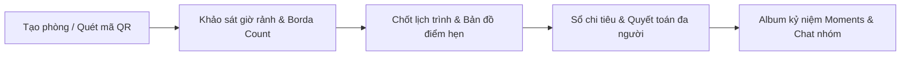

# LetsPlay-FE — Frontend Web Client cho Kèo

> Ứng dụng web Single Page Application (SPA) xây dựng bằng **React 19**, **TypeScript**, **Vite** và **Tailwind CSS v4** cho nền tảng **Let's Play (Kèo)** — giúp nhóm bạn tạo phòng hẹn tức thì, bình chọn khung giờ rảnh, chốt lịch trình, chia tiền sòng phẳng và lưu lại kỷ niệm qua album ảnh tập thể.

[](https://github.com/ttn6996/Let-sPlay-FE/actions/workflows/ci.yml)
[](https://react.dev/)
[](https://www.typescriptlang.org/)
[](https://vitejs.dev/)
[](https://tailwindcss.com/)
[](https://maplibre.org/)

**Hệ sinh thái Let's Play:** [LetsPlay-BE](https://github.com/ttn6996/Let-sPlay-BE) | **LetsPlay-FE** | [Lets-Play-Spec](https://github.com/NguynNe3110/Lets-Play-Spec)

---

## Mục lục

- [Tổng quan & Trải nghiệm người dùng](#tổng-quan--trải-nghiệm-người-dùng)
- [Tính năng nổi bật](#tính-năng-nổi-bật)
- [Tech Stack & Thư viện sử dụng](#tech-stack--thư-viện-sử-dụng)
- [Cấu trúc mã nguồn](#cấu-trúc-mã-nguồn)
- [Cài đặt & Khởi chạy Local](#cài-đặt--khởi-chạy-local)
- [Biến môi trường (.env)](#biến-môi-trường-env)
- [Giao thức Realtime SSE & Đồng bộ trạng thái](#giao-thức-realtime-sse--đồng-bộ-trạng-thái)
- [Bản đồ & Tích hợp dịch vụ bên ngoài](#bản-đồ--tích-hợp-dịch-vụ-bên-ngoài)
- [Kiểm thử mã nguồn, Lint & CI/CD](#kiểm-thử-mã-nguồn-lint--cicd)
- [Triển khai Production (Vercel / Netlify / Nginx)](#triển-khai-production-vercel--netlify--nginx)

---

## Tổng quan & Trải nghiệm người dùng

**LetsPlay-FE** được thiết kế hướng tới triết lý **Zero-Friction (Không rào cản)**:
- **Không ép đăng ký tài khoản:** Bất kỳ ai nhận được đường link hoặc quét mã QR đều có thể tham gia phòng ngay lập tức chỉ với một biệt danh (Display Name). Phiên khách được lưu trữ an toàn trong `sessionStorage`.
- **Nâng cấp tài khoản tùy chọn:** Cho phép người dùng liên kết với tài khoản Google (qua Google One-Tap / Identity Services) bất cứ lúc nào để đồng bộ các phòng hẹn sang thiết bị khác mà không làm mất dữ liệu hiện tại.
- **Tối ưu hóa di động (Mobile-First):** Giao diện tương thích toàn diện với màn hình điện thoại di động, thanh công cụ tích hợp (Room Toolkit) dạng bottom sheet và hiệu ứng chuyển động mượt mà với GSAP.

---

## Tính năng nổi bật



1. **Khảo sát giờ rảnh thông minh (Availability Poll):**
   - Chủ phòng thiết lập các mốc ngày/giờ dự kiến.
   - Thành viên tích chọn nhiều khung giờ phù hợp; hệ thống tính điểm đồng thuận và gợi ý khung giờ có số người tham gia đông nhất.
   - Hỗ trợ gửi phản hồi và bình luận thảo luận ẩn danh theo từng mốc thời gian.
2. **Lập kế hoạch liên tục & Khóa lịch trình (Continuous Planning):**
   - Đề xuất hoạt động, điểm ăn uống, vui chơi kèm dự toán chi phí.
   - Bình chọn 3 mức (Pass / Support / Strong). Khi chủ phòng đưa đề xuất vào lịch trình chính thức, đề xuất được khóa an toàn để tránh xung đột chỉnh sửa.
3. **Sổ quỹ & Chia tiền nhóm sòng phẳng (Shared Expenses):**
   - Ghi nhận chi tiết các khoản chi: hỗ trợ **nhiều người cùng thanh toán** và **nhiều người cùng chia sẻ**.
   - Tự động tính toán bảng cân đối thu chi cá nhân và gợi ý sơ đồ chuyển tiền tối giản số giao dịch.
   - Ghi vết lịch sử chỉnh sửa rõ ràng, giữ nguyên danh tính người sửa kể cả khi thành viên rời phòng.
4. **Bản đồ tương tác & Dự báo thời tiết:**
   - Tích hợp vector map qua **MapLibre GL JS** kết nối tile vector miễn phí từ OpenFreeMap.
   - Định vị điểm hẹn, điểm xuất phát chung và phối hợp đi chung xe (Ride sharing).
   - Tự động lấy dự báo thời tiết theo tọa độ điểm hẹn qua API Open-Meteo.
5. **Kho lưu giữ khoảnh khắc (Moments Album):**
   - Tải lên ảnh kỷ niệm của chuyến đi, hiển thị dạng dòng thời gian (timeline).
   - Thả biểu cảm cảm xúc (reactions) và bình luận trực tiếp trên từng bức ảnh.

---

## Tech Stack & Thư viện sử dụng

| Công nghệ / Thư viện | Phiên bản | Vai trò & Mục đích sử dụng |
|---|---|---|
| **React** | `19.2.7` | Thư viện UI hiện đại với Concurrent features |
| **TypeScript** | `6.0.2` | Kiểm soát kiểu dữ liệu tĩnh nghiêm ngặt trên toàn dự án |
| **Vite** | `8.1.0` | Build tool và Development server siêu tốc |
| **Tailwind CSS** | `4.3.1` | Utility-first CSS framework v4 với hiệu năng cao |
| **React Router** | `7.18.0` | Điều hướng client-side SPA (`/`, `/room/:roomId`,...) |
| **MapLibre GL JS** | `6.17.0` | Hiển thị bản đồ vector mã nguồn mở (WebGL) |
| **GSAP** | `3.15.1` | Thư viện chuyển động và hiệu ứng giao diện mượt mà |
| **Lucide React** | `1.70.0` | Bộ icon SVG hiện đại, đồng nhất |
| **Axios** | `1.18.1` | Client HTTP giao tiếp REST API với Backend |
| **qrcode.react** | `4.2.0` | Tạo mã QR Code chia sẻ phòng hẹn tức thì |
| **ESLint & TypeScript-ESLint**| `10.5` / `8.61` | Linting và đảm bảo chất lượng code theo chuẩn React 19 |

---

## Cấu trúc mã nguồn

```text
LetsPlay-FE/
├── .github/workflows/
│   └── ci.yml                 # GitHub Actions: Lint verification & Vite build
├── src/
│   ├── main.tsx               # Điểm khởi đầu của ứng dụng React
│   ├── App.tsx                # Thiết lập Routes (HomePage, RoomPage)
│   ├── api.ts                 # Toàn bộ API client gọi backend (Axios instance + auth headers)
│   ├── types.ts               # Định nghĩa TypeScript Interfaces (Room, Member, Expense,...)
│   ├── notifications.ts       # Service Worker & Web Push Notifications subscription
│   ├── styles.css             # Tailwind v4 configuration & theme tokens
│   ├── pages/
│   │   ├── HomePage.tsx       # Trang chủ: Tạo phòng, tham gia bằng mã mời, danh sách gần đây
│   │   └── RoomPage.tsx       # Màn hình phòng chính: SSE realtime listener, quản lý tab
│   ├── components/
│   │   ├── RoomToolkit.tsx    # Thanh công cụ toàn diện: Lịch trình, Chi tiêu, Đi chung xe, Album
│   │   ├── AvailabilityPanel.tsx # Bảng khảo sát và bình chọn khung giờ rảnh
│   │   ├── LocationMap.tsx    # Component bản đồ MapLibre GL, tìm kiếm tọa độ điểm hẹn
│   │   ├── GoogleSignInButton.tsx # Nút đăng nhập Google Identity One-Tap
│   │   └── ConnectionStatus.tsx   # Huy hiệu hiển thị trạng thái kết nối mạng / SSE
│   └── hooks/                 # Custom React hooks
├── public/                    # Static assets & PWA icons
├── eslint.config.js           # Cấu hình flat config cho ESLint v9/v10
├── package.json               # Dependencies và npm scripts
├── tsconfig.json              # Thiết lập TypeScript compiler
└── vite.config.ts             # Cấu hình Vite & Tailwind plugins
```

---

## Cài đặt & Khởi chạy Local

### Yêu cầu tiên quyết
- **Node.js 20 LTS** trở lên (khuyến nghị `v20.x` hoặc `v22.x`).
- **npm** đi kèm Node.js.

### 1. Cài đặt thư viện dependencies

```bash
cd source/LetsPlay-FE
npm ci
```

### 2. Thiết lập biến môi trường

Sao chép file `.env.example` thành `.env`:

```powershell
# Trên Windows PowerShell
Copy-Item .env.example .env

# Trên Linux / macOS
cp .env.example .env
```

Nội dung cấu hình mẫu trong `.env`:
```properties
VITE_API_URL=http://localhost:8082
VITE_PORT=5175
```

### 3. Khởi chạy Development Server

```bash
npm run dev
```

Mở trình duyệt tại: `http://localhost:5175`

---

## Biến môi trường (.env)

| Tên biến | Mặc định | Mô tả |
|---|---|---|
| `VITE_API_URL` | `http://localhost:8082` | URL của backend `LetsPlay-BE` |
| `VITE_PORT` | `5175` | Cổng chạy local của Vite development server |

> **Lưu ý:** Google Client ID và Khóa công khai VAPID Web Push được lấy tự động từ endpoint `/api/system/public-config` của backend, không cần khai báo trùng lặp ở frontend.

---

## Giao thức Realtime SSE & Đồng bộ trạng thái

1. Khi người dùng mở phòng, ứng dụng tự động mở kết nối Server-Sent Events tới:
   `GET ${VITE_API_URL}/api/rooms/${roomId}/events`
2. Kèm theo header `Authorization: Bearer <member_token>` và `Last-Event-ID` là revision gần nhất client nhận được.
3. Khi nhận sự kiện thay đổi dữ liệu (`room.updated`, `expense.created`, `comment.added`), component tự động cập nhật snapshot mới mà không cần người dùng tải lại trang (reload).
4. Khi mất kết nối hoặc đổi mạng, SSE client có cơ chế tự động reconnect với số revision gần nhất, đảm bảo không bỏ sót sự kiện.

---

## Bản đồ & Tích hợp dịch vụ bên ngoài

- **Bản đồ vector:** Sử dụng vector tile từ OpenFreeMap thông qua thư viện `maplibre-gl`. Không yêu cầu token hoặc thẻ tín dụng thanh toán.
- **Thời tiết:** Gọi trực tiếp Open-Meteo API theo kinh độ/vĩ độ của điểm hẹn, cung cấp thông tin nhiệt độ và dự báo thời tiết thời điểm diễn ra buổi hẹn.
- **Lịch Google:** Khi người dùng bấm đồng bộ lịch, ứng dụng yêu cầu cấp quyền OAuth scope `calendar.events` trực tiếp tại client và đẩy sự kiện lên Google Calendar của cá nhân.

---

## Kiểm thử mã nguồn, Lint & CI/CD

### Kiểm tra cú pháp & Linting
Dự án sử dụng ESLint với cấu hình Flat Config hỗ trợ React 19 Hooks:
```bash
npm run lint
```

### Kiểm tra kiểu dữ liệu TypeScript & Đóng gói Production
```bash
npm run build
```
Lệnh trên thực hiện kiểm tra kiểu tĩnh toàn bộ tệp qua `tsc -b`, sau đó đóng gói bundle tối ưu dung lượng và tree-shaking với `vite build`.

### GitHub Actions CI
Workflow [`.github/workflows/ci.yml`](.github/workflows/ci.yml) tự động kích hoạt ở **mỗi lần `push` và `pull_request`**:
1. Khởi tạo môi trường **Node.js 20**.
2. Cài đặt dependencies sạch qua `npm ci` có bộ nhớ đệm cache.
3. Chạy kiểm tra linting (`npm run lint`).
4. Kiểm tra kiểu dữ liệu và build ứng dụng (`npm run build`).

---

## Triển khai Production (Vercel / Netlify / Nginx)

### Triển khai lên Vercel
1. Kết nối repository `LetsPlay-FE` với tài khoản Vercel.
2. Cấu hình **Root Directory:** `source/LetsPlay-FE` (nếu nằm trong monorepo) hoặc thư mục gốc.
3. Thêm biến môi trường:
   - `VITE_API_URL`: URL dịch vụ backend triển khai thực tế (ví dụ: `https://letsplay-be.onrender.com`).
4. Vercel sẽ tự động build và cấp domain HTTPS miễn phí.

### Đóng gói Docker / Nginx
```bash
# Build production bundle
npm run build
# Thư mục output sẵn sàng deploy nằm tại: dist/
```
Có thể phục vụ thư mục `dist/` bằng bất kỳ web server tĩnh nào (Nginx, Caddy, Cloudflare Pages, S3/CloudFront) có cấu hình fallback mọi request về `index.html` (SPA routing).
